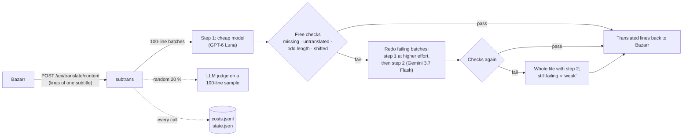

# LLM subtitle translation

A small, production-running service that translates subtitles (English → Dutch) with LLMs, and the benchmark used to
pick its models. It works as a minimal **AI gateway**: tiered model routing with fallback across providers, free
automated quality gates, an LLM judge on a sample, per-app API keys with a monthly cap, and **exact cost per call**.

- `subtrans/`: the service (Python, standard library only), compatible with the Lingarr API that
  [Bazarr](https://www.bazarr.media/) uses as a translator.
- `bench/`: the benchmark: translate the same passages with 20+ models, score them with chrF, a line-alignment
  check and blind LLM judges anchored on a human translation.
- `spend/`: spend and budget per app and per model, as one JSON status for a dashboard.
- `tests/`: unit tests for parsing and the quality checks.

In production since October 2026: about 1,900 translation calls in the first three weeks, for under €3 in total.

## How a translation flows



- **Routing and fallback**: a batch with missing or unparsable lines is retried once, then sent to the other step's
  model (another model family), so one bad batch never leaves English on screen.
- **Quality gates without an LLM**: four cheap checks run on every translation (below). Only what fails is redone.
- **LLM judge for the quality figure only**: a third model family (Claude Sonnet 5.5) scores a 100-line sample of
  one in five translations. It reports quality; it doesn't decide anything, because on every file it would cost
  more than the translation itself.
- **Cost attribution**: every call's exact cost (OpenRouter `usage.cost`) goes to `costs.jsonl` with its kind
  (translate/judge), model and title. `GET /api/stats` gives totals, this month, per step, the step-1 failure rate
  and the API key's usage against its cap.
- **Budget isolation**: each app has its own OpenRouter key with a monthly cap (translations, benchmarks, other
  apps), so a runaway benchmark can't stop production. The key file is read on every call, so a rotated key works
  without a restart.

## Spend and budgets

`spend/openrouter-spend.py` runs from cron and writes one JSON status (no secrets) that a dashboard reads:

- **Per key, so per app**: monthly cap, remaining, spend today, this week and this month, and a projected month-end.
  Benchmarks are one-offs, so they're counted once instead of extrapolated.
- **Per model**: from the service's own per-call log, with the exact cost OpenRouter reports.
- **Account balance**, and the key that must not stop (the production app), for a single "is production safe" tile.
- If a key was deleted mid-month, its spend disappears from the key totals; the per-call log then gives the fuller
  picture, and the status says which source it used.

```sh
KEYS="Subtitles=subtitles.key,Benchmarks=bench.key" COSTS=data/costs.jsonl OUT=status.json python3 spend/openrouter-spend.py
```

## The free quality checks

| Check | Fails above | Catches |
|---|---|---|
| missing | 2 % of lines empty or not returned | dropped lines |
| untranslated | 3 % of lines (≥ 4 words) identical to the English | English left on screen |
| odd_length | 3 % of lines (English ≥ 25 characters) with a Dutch/English length ratio outside 0.4–2.2 | merged or split lines |
| shifted | 1.5 % of 8-line windows where the Dutch line lengths follow the English of the line before or after better than their own | text on the wrong line, which appears at the wrong moment on screen |

The limits were calibrated on the benchmark output: every model the benchmark flagged for shifting or dropping
lines fails them, every model it rated well passes (GPT-6 Luna: 0.5 % shifted windows).

## The benchmark

**Question:** which model gives the best Dutch subtitles for the money?

**Test set:** 4 episodes of different US series (drama and comedy) that have both an English subtitle and a human
Dutch one. Two 100-line passages each: 8 passages, 800 lines per model. Every model gets exactly the request
Bazarr sends (its system prompt + a JSON list of lines).

**Measures:**
1. **chrF** against the human Dutch lines of the same time window (standard MT metric).
2. **Shifted lines**: a line whose text matches the other models' consensus for the line before or after better
   than for its own. chrF compares whole passages and misses this.
3. **Blind judges**: Claude Sonnet 5.5 and GPT-6 Sol (different families, neither judging alone) score each Dutch
   passage against the English (accuracy, fluency, subtitle style, overall 0–100) without knowing who made it.
   The **human subtitle** of the same window is judged too, as an anchor.
4. **Cost**: exact per call, scaled to an average episode (26,000 Dutch characters).
5. A blind by-eye review of the 24 lines where the models disagreed most.

The whole benchmark cost about €2.50 on OpenRouter plus about €0.40 on Google's API. Amounts are in euros; OpenRouter
bills in US dollars, converted at 0.86.

### Results

| Model | Judges (overall) | chrF | Shifted lines | € / episode | s / 100 lines |
|---|---|---|---|---|---|
| **GPT-6 Luna** | **79.4** | 72.0 | 0.1 % | **0.008** | 13 |
| **Gemini 3.7 Flash** (Google direct) | **80.3** | **78.1** | 0.3 % | 0.185 | 10 |
| Gemini 3.7 Flash via OpenRouter | 79.2 | 78.4 | – | 0.112 | 20 |
| Gemini 3.8 Flash | 79.7 | 76.9 | 0.4 % | 0.183 | 11 |
| Claude Sonnet 5.5 (as translator) | 77.6 | 74.1 | – | 0.276 | 20 |
| DeepSeek V4.1 Flash (thinking) | 76.6 | 73.9 | 0 % | 0.040 | 97 |
| DeepSeek V4.1 Flash (no thinking) | 69.1 | 70.4 | 0 % | 0.013 | 17 |
| Gemini 3.5 Flash-Lite | 69.7 | 71.6 | 3.1 % ❌ | 0.093 | 7 |
| DeepSeek V4 Flash | 69.2 | 72.2 | 3.3 % ❌ | 0.007 | 39 |
| *Human subtitle (anchor)* | *68.6* | – | – | – | – |
| GLM 5.3 Flash | 64.7 | 70.7 | 1.1 % | 0.010 | 26 |
| Gemma 4 31B | 63.1 | 71.3 | 0 % | 0.007 | 51 |
| Claude Haiku 4.5 | 59.3 | 67.7 | 4.1 % ❌ | 0.126 | 21 |
| Llama 3.3 70B / Mistral Small | – | ~69 | 4 % / 30 % ❌ | 0.015 | – |
| GPT-5 mini | – | 61.4 | 7.4 % ❌ | 0.044 | 16 |
| Local qwen3:30b (Ollama, CPU) | – | – | – | 0 | > 1000 |

### Conclusions

1. **GPT-6 Luna is the price/quality winner**: within a point of Gemini on both judges, no shifted lines, fast,
   at about 1/23 of Gemini's direct price.
2. **Gemini 3.7 Flash has the best quality**, and via OpenRouter it is 40 % cheaper than through Google directly
   (Google's invoice came out at 1.63× its list price). That makes it the second step.
3. Paying more doesn't buy better subtitles here: Sonnet 5.5 is the most *accurate* but less natural. Humans score
   lower because they condense on purpose.
4. **chrF alone would have picked the wrong models**: two models with good chrF shift text onto the wrong line.
   Line alignment has to be checked, which led to the `shifted` check.
5. Free and local models weren't practical: rate limits, and CPU inference took over 18 minutes per 100 lines.

**Caveats:** 800 lines from 4 series separate tiers, not models a point apart (within ~2 points is a tie). The
judges are LLMs; that's mitigated by two families, a blind and shuffled order and a human anchor, and checked
against chrF, the alignment measure and a by-eye review. Prices change; the service records the real cost per call.

## Running it

```sh
# the service
cp subtrans/compose.example.yaml compose.yaml   # put your OpenRouter key in ./secrets/subtitles.key
docker compose up -d
curl -s localhost:8791/api/stats

# the benchmark: <name>.en.srt + <name>.nl.srt pairs in ./pairs (not included: subtitles are copyrighted)
cd bench
OPENROUTER_KEY=... PAIRS=../pairs RUN=bench1 python3 bench.py
OPENROUTER_KEY=... RUN=bench1 MODELS="openai/gpt-6-luna,google/gemini-3.7-flash,human" python3 judge.py

# tests
python3 -m unittest discover tests
```

Settings (environment): `TIER1`, `TIER2`, `JUDGE`, `JUDGE_RATE`, `RETRY_EFFORTS`, `OPENROUTER_KEY_FILE`, `DATA`,
`PORT`. In Bazarr: translator `lingarr`, URL `http://subtrans:9876`.

## License

MIT
